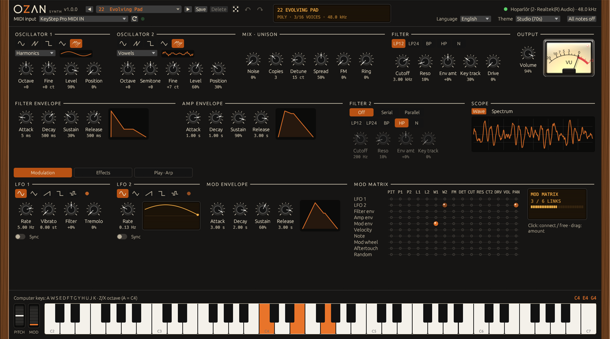
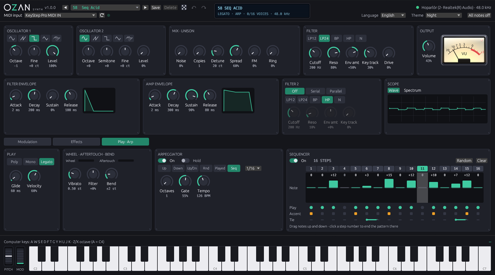

<p align="center"></p>

# OZAN Synth

An open-source software synthesizer written in Rust, built up step by step.
Play it with a USB MIDI keyboard, the computer keyboard or the mouse.

*Ozan* (oh-ZAHN) is Turkish for a wandering poet-musician, the bard who travels with his instrument.
The logo is drawn from geometry in `assets/make_logo.py`: the Z is a saw tooth, the A an envelope's attack.

*Türkçe açıklama aşağıda.*

<p align="center"></p>
<p align="center"></p>

## Download

**Windows 10/11 (64-bit):** get `OZAN-Synth-<version>-Setup.exe` from
[Releases](https://github.com/sozden/ozan-synth/releases). It installs the standalone
program (Start menu), the **VST3** plugin (`C:\Program Files\Common Files\VST3`) and the
**CLAP** plugin (`C:\Program Files\Common Files\CLAP`); each can be left out. Your own
presets and settings (`%APPDATA%\Ozan`) stay when you uninstall.

The installer is not code-signed, so Windows SmartScreen may say it is from an unknown
publisher: choose **More info → Run anyway**. Tested in Waveform Free 14; any host that
loads VST3 or CLAP instruments should work.

## Features

- Classic subtractive voice: 2 oscillators → resonant filter → amplifier, 16 voices, stereo output
- Band-limited sine, saw, square and triangle (PolyBLEP / PolyBLAMP — no aliasing whine on high notes)
- Oscillator octave, semitone (osc 2), fine tune and level
- Wavetable oscillator with 5 built-in tables (basic shapes, pulse width, harmonics, vowels, sync sweep), 32 frames each, one band-limited copy per octave so high notes do not alias
- Arpeggiator: up, down, up-down, random and played order; 1/4 to 1/32 with triplets, 1–4 octaves, gate, hold; follows the host's tempo in a DAW, its own tempo knob otherwise; steps land on the exact sample
- Poly, mono and legato play modes (mono keeps a stack of held keys), glide (portamento), velocity sensitivity, white noise source
- Unison: up to 7 detuned copies per oscillator, spread across the stereo field at constant loudness
- Second LFO and a third (mod) envelope, both as matrix sources
- Modulation matrix: 6 slots, sources LFO 1 and 2, filter/amp/mod envelope, velocity, note, mod wheel, aftertouch, random-per-note; destinations pitch, wavetable position, levels, cutoff, resonance, volume, pan, unison detune
- Zero-delay-feedback state-variable filter: LP 12 dB, LP 24 dB, band-pass, high-pass, notch; cutoff, resonance, envelope amount (±7 octaves), key tracking, drive (soft saturation before the filter, with a DC blocker)
- Second filter, serial (after the first) or parallel (side by side), with its own type, cutoff, resonance, envelope amount and key tracking; its cutoff is also a matrix destination
- Separate ADSR envelopes for filter and amplifier
- Gentle output saturation instead of hard clipping
- LFO (sine, triangle, ramp, square, sample & hold) for vibrato, filter wobble and tremolo
- Tempo sync for both LFOs and the delay: note lengths from 4 bars to 1/32, dotted and triplet; follows the DAW's tempo, or the arpeggiator's Tempo knob in the standalone program
- FM and ring modulation: oscillator 2 bends oscillator 1's phase (FM, also a matrix destination) and their product joins the mix (ring)
- 16-step sequencer (the arpeggiator's Seq pattern): per step a note ±24 semitones from the key held, play/rest, accent and tie (ties slide in Mono and Legato); pattern length 1–16, a random pentatonic pattern in one click; the key you hold moves the whole pattern
- Undo and redo (Ctrl+Z, Ctrl+Y or the arrows by the preset name): every finished change is a step, up to 100
- Dice: a random sound in one click, or only its oscillators, filters, envelopes, modulation or effects (right-click); its level is matched to the factory presets
- Mod wheel and aftertouch: extra vibrato and cutoff; adjustable pitch-bend range
- Effects, in this order: distortion (soft, hard or folding, with tone and an even level), 6-stage stereo phaser with feedback, stereo chorus, delay (ping-pong, darkening repeats, tape-like glide when the time is turned), reverb (8-line feedback delay network: size, decay, damping, pre-delay), 3-band EQ (250 Hz and 4 kHz shelves, 1 kHz bell, ±12 dB); each fades in and out when switched
- Presets: 62 factory sounds (basses, leads, pads, keys, plucks, arpeggios, sequences, FM and ring sounds, effects), save/delete your own (JSON in `%APPDATA%\Ozan\presets`), step with ◀ ▶ or MIDI program change; a browser (click the preset name or the header screen) with categories, search and favorites, arrow keys loading as you go
- USB MIDI input (all channels): notes, velocity, sustain pedal, pitch bend, mod wheel, aftertouch, program change, all-notes-off
- MIDI keyboards are found and connected automatically
- MIDI learn (standalone program): right-click a knob, choose *MIDI learn*, turn a knob on your controller; bindings are remembered
- Panel laid out along the signal path: oscillators, mix and unison, filter and output on top, the envelopes and scope below them, and tabs for modulation, effects, and play and arpeggiator; sections in a row line up edge to edge
- A small backlit screen in the header (amber in Studio, pale blue in Night) shows the preset and, for a moment, the control you just moved with its value; LFO 2 has the same kind of screen
- Modulation matrix as a pin board, sources down the side and destinations across: click a hole to connect or free it, drag a pin up and down for its amount (orange positive, blue negative)
- Backlit analogue VU meter in a metal case, with glass and a clip light
- Pitch and mod wheels beside the on-screen keyboard: they follow your controller and can be moved with the mouse
- Knobs (drag up/down, Shift for fine, double-click for default, mouse wheel), envelope graphs, analogue VU meter, and a live scope: triggered waveform or log-frequency spectrum of the output
- English or Turkish interface, and two looks, chosen in the header and remembered: **Studio** (1970s style — wooden end cheeks, skirted knobs, cream lettering) and **Night** (dark cards with screws, jade green)
- On-screen keyboard (C2–C7) that also shows the notes coming from MIDI
- Computer keyboard: `A W S E D F T G Y H U J K O L`, `Z`/`X` change octave

## Building

```
cargo run --release -p ozan
```

Needs Rust 1.85 or newer. On Windows, a MIDI input can be used by one program at a
time — close your DAW (or let it release the keyboard) before connecting here.

The installer is built with [Inno Setup 6](https://jrsoftware.org/isinfo.php)
(`winget install JRSoftware.InnoSetup`):

```
powershell -NoProfile -ExecutionPolicy Bypass -File scripts\installer.ps1
```

builds the program and the plugins, checks the plugin, and writes
`dist\OZAN-Synth-<version>-Setup.exe` (script: `installer\ozan.iss`). The program's icon
and version details are put into `ozan.exe` by `crates/ozan/build.rs` with the Windows
SDK's `rc.exe`.

## Plugin (CLAP / VST3)

```
powershell -ExecutionPolicy Bypass -File scripts\bundle.ps1
```

builds `dist\OZAN Synth.clap` and `dist\OZAN Synth.vst3`, then loads the CLAP once in a
small test host (`ozan-lab plugin`) to check that it plays. Copy the `.vst3` folder to
`C:\Program Files\Common Files\VST3` (or point your DAW at `dist`), the `.clap` file to
`C:\Program Files\Common Files\CLAP`.

The plugin opens the same panel as the standalone program (theme and language follow
the program's settings); the edited sound is saved with the DAW project. Presets you
save in the program appear in the plugin and the other way round (same folder). For automation
the host also sees a **Preset** selector and relative controls that leave the sound alone
at their defaults: volume, cutoff, resonance, filter envelope amount, attack and release,
LFO rate, wavetable position, unison detune, glide, and chorus/delay/reverb mix.
`ozan-lab plugin-gui <file.clap>` opens the plugin's window in a small test host. Built with [nih-plug](https://github.com/robbert-vdh/nih-plug) (ISC),
pinned to a reviewed commit.

## Layout

| Crate | What it holds |
|---|---|
| `crates/ozan-core` | Sound engine: oscillators, filters, envelopes, LFOs, voices, arpeggiator and sequencer, effects, MIDI parsing, factory presets, the dice. No required dependencies (`serde` optional), no allocation while rendering. |
| `crates/ozan` | Standalone program: sound card (`cpal`), MIDI (`midir`), panel (`egui`). |
| `crates/ozan-ui` | Interface shared by the program and the plugin (egui 0.31): theme, knobs, meters, logo, translations, settings, the sound panel. |
| `crates/ozan-plugin` | CLAP and VST3 instrument through nih-plug and nih_plug_egui: the panel in the plugin window, preset selector and relative macro parameters. |
| `crates/ozan-lab` | Listening lab (not shipped): renders every preset to WAV with spectrograms and measurements, records the real output via WASAPI loopback. |

Events from MIDI and the panel reach the audio thread through a lock-free queue (`rtrb`).

## Listening lab

```
cargo run --release -p ozan-lab -- render lab-out        # every preset: WAV + spectrogram + table
cargo run --release -p ozan-lab -- loopback 7 out.wav    # record what the computer plays, look for dropouts
cargo run --release -p ozan-lab -- analyze out.wav       # measure a recording again
```

The test phrase plays a low note, a chord, a mod-wheel sweep, a pitch-bend swing, fast
repeated notes and a high C7 (to show aliasing). The table lists peak and RMS level, DC
offset, the level after all notes end, and a click score at every note start/end.

## Roadmap

1. ~~Single sine voice, MIDI, audio~~ → done, with polyphony and ADSR
2. ~~Classic synth: band-limited saw/square/triangle (PolyBLEP), resonant filter, second oscillator~~ → done
3. ~~Modulation: LFO, mod wheel, presets (save/load)~~ → done, with aftertouch and program change
4. ~~Effects: chorus, delay, reverb~~ → done
5. ~~Wavetable oscillator, unison, modulation matrix~~ → done
6. ~~VST3/CLAP plugin with `nih-plug`~~ → done, with the full panel as the plugin window
7. ~~1.0: second filter, tempo sync, FM and ring, step sequencer, distortion, phaser and EQ, preset browser, undo, dice, installer~~ → done (see [CHANGELOG](CHANGELOG.md))

Ideas for later: per-step probability and pattern memory in the sequencer, velocity
curves, MIDI learn inside the plugin, macOS and Linux builds.

## Thanks

Thanks to my dear friend **Doğan Coşku Arşiray**, who helped me so much in finding my way
around synthesizers.

---

## Türkçe

OZAN Synth, Rust ile yazılmış, adım adım büyütülen açık kaynak bir yazılım synthesizer.
Adı, sazıyla diyar diyar gezen halk şairinden geliyor.
USB MIDI klavye, bilgisayar klavyesi ya da fareyle çalınır.

**İndirme (Windows 10/11, 64 bit):** [Releases](https://github.com/sozden/ozan-synth/releases)
sayfasından `OZAN-Synth-<sürüm>-Setup.exe` dosyasını indir. Kurulum bağımsız programı,
**VST3** ve **CLAP** eklentilerini kurar (her biri seçilebilir); kaldırınca kendi
preset'lerin ve ayarların (`%APPDATA%\Ozan`) silinmez. Kurulum dosyası imzalı olmadığı
için Windows SmartScreen uyarı verebilir: **Ek bilgi → Yine de çalıştır**.

**Özellikler:** 16 sesli, iki osilatörlü klasik synth. Aliasing'siz sinüs, testere,
kare ve üçgen dalgalar; rezonanslı filtre (LP12, LP24, BP, HP), filtre ve amfi için ayrı
ADSR zarfları. LFO (vibrato, filtre, tremolo), mod tekeri ve aftertouch. Stereo chorus,
delay (ping-pong) ve reverb efektleri. Wavetable osilatör (5 tablo), 7 kopyaya kadar unison
ve 6 slotlu mod matrisi. Poly/mono/legato, glide, velocity hassasiyeti, gürültü, arpejiyatör (DAW temposunu izler), ikinci LFO ve mod zarfı; çıkışın canlı dalga biçimi ve spektrumu; filtrede drive ve notch; MIDI learn (knob'a sağ tıkla, kontrolcünde bir düğme çevir). Panel ses yolunu izler: üstte osilatörler, miks, filtre ve çıkış, altında zarflar ve osiloskop; modülasyon, efektler ve çalma/arpejiyatör sekmelerde. Başlıktaki küçük ekran preset'i ve son çevrilen knobu gösterir; klavyenin yanında pitch ve mod tekerleri var. Mod matrisi bir pin panosu: deliğe tıkla bağla/çöz, pini yukarı-aşağı sürükle miktarı ayarla. İkinci filtre (seri/paralel) ve tempoya kilitli LFO'lar ile delay. FM ve ring modülasyonu (OSC2 → OSC1). 16 adımlı sıralayıcı (arpejiyatörün Dizi deseni): adım başına nota, çal/sus, vurgu ve bağ; basılı tuş deseni taşır. Distortion (yumuşak/sert/katlama), phaser ve 3 bantlı EQ. Preset tarayıcısı (preset adına ya da başlık ekranına tıkla): kategoriler, arama, favoriler; ok tuşlarıyla gezerken yükler. Geri al / yinele (Ctrl+Z, Ctrl+Y ya da preset adının yanındaki oklar), 100 adıma kadar. Zar: tek tıkla rastgele ses ya da sağ tıkla yalnız bir bölüm; ses seviyesi fabrika preset'lerine göre ayarlanır. 62 fabrika
preset'i; kendi preset'lerini kaydedip silebilir, MIDI program change ile seçebilirsin.
USB MIDI otomatik bağlanır; Stüdyo (70'ler) ve Gece temaları arasında seçim yapılır.
Ayrıca CLAP/VST3 eklentisi olarak DAW içinde çalışır; kendi preset'lerin uygulama ile
eklenti arasında ortaktır (`scripts\bundle.ps1`).

**Çalıştırma:** `cargo run --release -p ozan`. Arayüz varsayılan olarak İngilizce;
başlıktaki **Language** menüsünden Türkçe seçilebilir.

Windows'ta bir MIDI girişini aynı anda tek program kullanabilir; DAW açıksa klavyeyi
bırakmasını sağlayın.

## Teşekkürler

Synth'lerle tanışmamda ve bu yolda bana çok yardımı dokunan sevgili arkadaşım
**Doğan Coşku Arşiray**'a teşekkürler.

## License

GPL-3.0-or-later — see [LICENSE](LICENSE).
