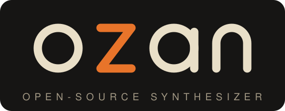

<p align="center"></p>

# Ozan

An open-source software synthesizer written in Rust, built up step by step.
Play it with a USB MIDI keyboard, the computer keyboard or the mouse.

*Ozan* (oh-ZAHN) is Turkish for a wandering poet-musician, the bard who travels with his instrument.

*Türkçe açıklama aşağıda.*

## Status — stage 4

- Classic subtractive voice: 2 oscillators → resonant filter → amplifier, 16 voices, stereo output
- Band-limited sine, saw, square and triangle (PolyBLEP / PolyBLAMP — no aliasing whine on high notes)
- Oscillator octave, semitone (osc 2), fine tune and level
- Zero-delay-feedback state-variable filter: LP 12 dB, LP 24 dB, band-pass, high-pass; cutoff, resonance, envelope amount (±7 octaves), key tracking
- Separate ADSR envelopes for filter and amplifier
- Gentle output saturation instead of hard clipping
- LFO (sine, triangle, ramp, square, sample & hold) for vibrato, filter wobble and tremolo
- Mod wheel and aftertouch: extra vibrato and cutoff; adjustable pitch-bend range
- Effects: stereo chorus, delay (ping-pong, darkening repeats, tape-like glide when the time is turned), reverb (8-line feedback delay network: size, decay, damping, pre-delay); each fades in and out when switched
- Presets: 12 factory sounds, save/delete your own (JSON in `%APPDATA%\Ozan\presets`), step with ◀ ▶ or MIDI program change
- USB MIDI input (all channels): notes, velocity, sustain pedal, pitch bend, mod wheel, aftertouch, program change, all-notes-off
- MIDI keyboards are found and connected automatically
- Panel with knobs (drag up/down, Shift for fine, double-click for default, mouse wheel), envelope graphs, analogue VU meter
- English or Turkish interface, and two looks, chosen in the header and remembered: **Studio** (1970s style — wooden end cheeks, skirted knobs, cream lettering) and **Night** (dark cards with screws)
- On-screen keyboard (C2–C7) that also shows the notes coming from MIDI
- Computer keyboard: `A W S E D F T G Y H U J K O L`, `Z`/`X` change octave

## Building

```
cargo run --release -p ozan
```

Needs Rust 1.85 or newer. On Windows, a MIDI input can be used by one program at a
time — close your DAW (or let it release the keyboard) before connecting here.

## Layout

| Crate | What it holds |
|---|---|
| `crates/ozan-core` | Sound engine: oscillators, filter, envelopes, LFO, voices, MIDI parsing, factory presets. No required dependencies (`serde` optional), no allocation while rendering — meant to run later inside a plugin too. |
| `crates/ozan` | Standalone program: sound card (`cpal`), MIDI (`midir`), panel (`egui`). |

| `crates/ozan-lab` | Listening lab (not shipped): renders every preset to WAV with spectrograms and measurements, records the real output via WASAPI loopback. |

Events from MIDI and the panel reach the audio thread through a lock-free queue (`rtrb`).

## Listening lab

```
cargo run --release -p ozan-lab -- render lab-out        # every preset: WAV + spectrogram + table
cargo run --release -p ozan-lab -- loopback 7 out.wav    # record what the computer plays, look for dropouts
cargo run --release -p ozan-lab -- analyze out.wav       # measure a recording again
```

The test phrase plays a low note, a chord, a mod-wheel sweep, a pitch-bend swing, fast
repeated notes and a high C7 (to show aliasing). The table lists peak and RMS level, DC
offset, the level after all notes end, and a click score at every note start/end.

## Roadmap

1. ~~Single sine voice, MIDI, audio~~ → done, with polyphony and ADSR
2. ~~Classic synth: band-limited saw/square/triangle (PolyBLEP), resonant filter, second oscillator~~ → done
3. ~~Modulation: LFO, mod wheel, presets (save/load)~~ → done, with aftertouch and program change
4. ~~Effects: chorus, delay, reverb~~ → done
5. Wavetable oscillator, unison, modulation matrix
6. VST3/CLAP plugin with `nih-plug`

---

## Türkçe

Ozan, Rust ile yazılmış, adım adım büyütülen açık kaynak bir yazılım synthesizer.
Adı, sazıyla diyar diyar gezen halk şairinden geliyor.
USB MIDI klavye, bilgisayar klavyesi ya da fareyle çalınır.

**Şu an (4. aşama):** 16 sesli, iki osilatörlü klasik synth. Aliasing'siz sinüs, testere,
kare ve üçgen dalgalar; rezonanslı filtre (LP12, LP24, BP, HP), filtre ve amfi için ayrı
ADSR zarfları. LFO (vibrato, filtre, tremolo), mod tekeri ve aftertouch. Stereo chorus,
delay (ping-pong) ve reverb efektleri. 12 fabrika
preset'i; kendi preset'lerini kaydedip silebilir, MIDI program change ile seçebilirsin.
USB MIDI otomatik bağlanır; Stüdyo (70'ler) ve Gece temaları arasında seçim yapılır.

**Çalıştırma:** `cargo run --release -p ozan`. Arayüz varsayılan olarak İngilizce;
başlıktaki **Language** menüsünden Türkçe seçilebilir.

Windows'ta bir MIDI girişini aynı anda tek program kullanabilir; DAW açıksa klavyeyi
bırakmasını sağlayın.

## License

GPL-3.0-or-later — see [LICENSE](LICENSE).
